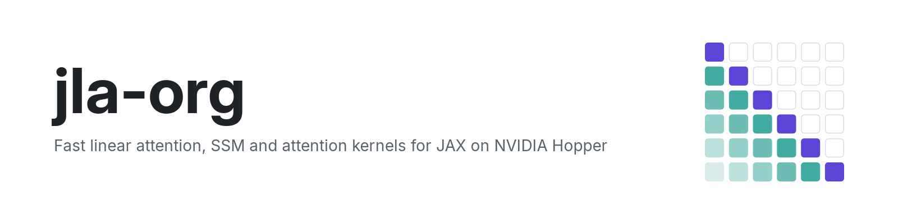
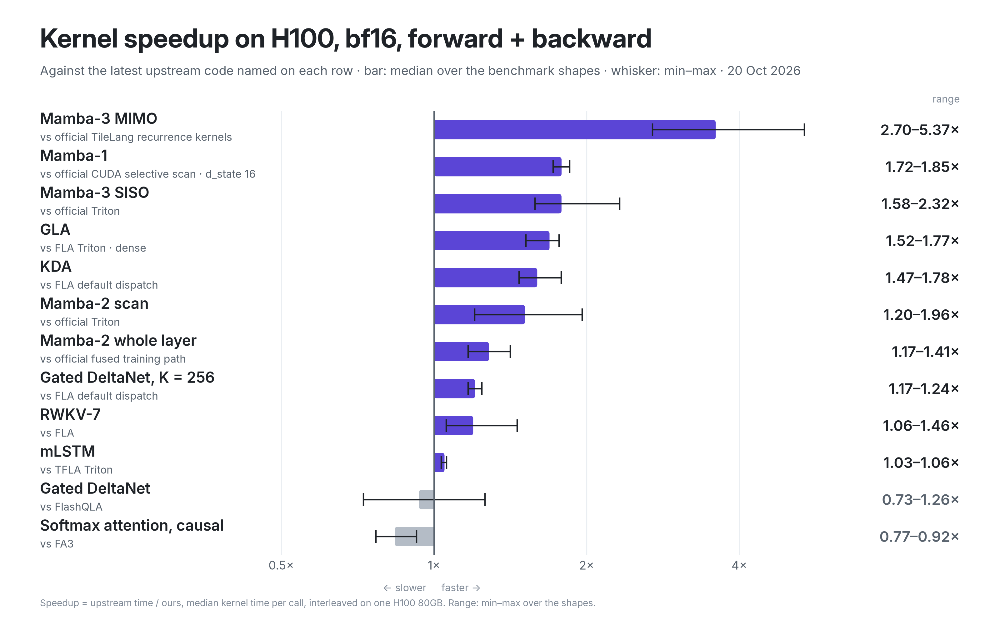

<p align="center">
  <a href="https://github.com/jla-org/jax-linear-attention">
    <picture>
      <source media="(prefers-color-scheme: dark)" srcset="./assets/profile-banner-dark.png">
      
    </picture>
  </a>
</p>

<p align="center">
  <a href="https://github.com/jla-org/jax-linear-attention"><b>Repository</b></a>
  &nbsp;·&nbsp;
  <a href="https://github.com/jla-org/jax-linear-attention#quick-start"><b>Quick start</b></a>
  &nbsp;·&nbsp;
  <a href="https://github.com/jla-org/jax-linear-attention/tree/main/docs"><b>Docs</b></a>
  &nbsp;·&nbsp;
  <a href="https://github.com/jla-org/jax-linear-attention/blob/main/benchmarks/README.md"><b>Benchmarks</b></a>
  &nbsp;·&nbsp;
  <a href="https://github.com/jla-org/jax-linear-attention/discussions"><b>Discussions</b></a>
  &nbsp;·&nbsp;
  <a href="https://discord.com/invite/rWuU7cWU4E"><b>Discord</b></a>
</p>

**jax-linear-attention brings FLA-class linear-attention kernels to JAX.**
Mamba-2 and Mamba-3, Gated DeltaNet, KDA, RWKV-7, GLA and an FA3-style attention kernel, written in
Pallas Mosaic GPU for NVIDIA Hopper, forward and backward, with a full LLM training stack around them.
Every kernel is exact by default and measured against the latest upstream code.

```sh
pip install "jax-linear-attention[cuda]"
```

Then call one op, `jla.ops.linear_attention(...)`, or train a model from one TOML with `jla train`.
The [quick start](https://github.com/jla-org/jax-linear-attention#quick-start) has both. It runs on
H100 and H200; on other devices every op falls back to plain JAX.

<table>
  <tr>
    <td width="50%" valign="top">
      <b>Kernels for the new layers</b><br>
      Mamba-2/3, Gated DeltaNet and DeltaNet, KDA, RWKV-7, GLA, Mamba-1, mLSTM and Gated DeltaNet-2,
      plus FA3-style softmax attention with packed documents, windows, GQA and sinks.
    </td>
    <td width="50%" valign="top">
      <b>Exact by default</b><br>
      Every recurrence ships three ways: a token-by-token reference, a chunked JAX op and the kernel.
      <code>impl="auto"</code> runs a kernel only where its GPU tests cover the call.
    </td>
  </tr>
  <tr>
    <td width="50%" valign="top">
      <b>A training stack around them</b><br>
      FSDP, data, tensor, expert and pipeline parallelism, FP8 training, dropless MoE, packed
      documents, exact resume, SFT and DPO, Hugging Face import and export, lm-evaluation-harness.
    </td>
    <td width="50%" valign="top">
      <b>Fast end to end</b><br>
      72.3% MFU on one H100 and 68.2% MFU per GPU on 8 H100s for a 1.3B transformer in FP8, and
      1.04-1.67x flame (FLA's trainer) in bf16 on the same tokens.
    </td>
  </tr>
</table>

### Measured in the open

<picture>
  <source media="(prefers-color-scheme: dark)" srcset="./assets/kernels-dark.png">
  
</picture>

<picture>
  <source media="(prefers-color-scheme: dark)" srcset="./assets/gdn2-paper-dark.png">
  
</picture>

- **[Kernels](https://github.com/jla-org/jax-linear-attention/blob/main/docs/kernels.md):** against
  the latest upstream code on one H100, forward + backward: Mamba-3 MIMO 2.70-5.37x the official
  recurrence kernels, the Mamba-2 scan 1.20-1.96x, KDA 1.47-1.78x FLA, GLA 1.52-1.77x FLA, Gated DeltaNet
  1.71-2.68x FLA's Triton kernels.
- **[End to end](https://github.com/jla-org/jax-linear-attention/blob/main/docs/results.md):** 1.3B
  models against flame on the same tokens: 1.04-1.67x in bf16 and 1.10-1.77x in FP8 against flame's
  FP8, and 1.47x flame per GPU for the transformer on 8 H100s.
- **[In the Gated DeltaNet-2 paper's setting](https://github.com/jla-org/jax-linear-attention/blob/main/benchmarks/gdn2_paper.md):**
  every 1.3B model of the paper's Figure 2 trains 1.14-1.41x faster on one H100 than the paper reports,
  with a 32,000-token vocabulary.
- **[Where we lose](https://github.com/jla-org/jax-linear-attention#where-we-lose):** FlashQLA beats
  our exact Gated DeltaNet split on long single sequences and few-head packed documents, and our
  FA3-style attention runs below FA3. Each case is listed with its numbers and the reason.

Every number was measured on H100s with no other jobs on the GPUs; the baseline commits and commands
are in [benchmarks/](https://github.com/jla-org/jax-linear-attention/tree/main/benchmarks).

### Open source

jax-linear-attention is free and open source under the
[Apache License 2.0](https://github.com/jla-org/jax-linear-attention/blob/main/LICENSE).
Contributions are welcome with a DCO sign-off
([CONTRIBUTING.md](https://github.com/jla-org/jax-linear-attention/blob/main/CONTRIBUTING.md)).
Parts of it follow or adapt flash-linear-attention, FlashAttention-3, Mamba, FlashQLA, FlashKDA,
Tokamax and JAX, credited in
[NOTICE](https://github.com/jla-org/jax-linear-attention/blob/main/NOTICE).

### Talk to us

- **Questions and ideas:** [Discussions](https://github.com/jla-org/jax-linear-attention/discussions)
- **Chat:** [Discord](https://discord.com/invite/rWuU7cWU4E)
- **Bugs:** [open an issue](https://github.com/jla-org/jax-linear-attention/issues/new/choose)
- **Security problems:** [report them privately](https://github.com/jla-org/jax-linear-attention/security/advisories/new), never in a public issue
- **Everything else:** [vikramlex@karlexai.com](mailto:vikramlex@karlexai.com) · [@vikram_lex on X](https://x.com/vikram_lex) · [karlex.ai](https://www.karlex.ai)

<sub>jax-linear-attention is made by <a href="https://www.karlex.ai"></a> <a href="https://www.karlex.ai">KarLex AI</a>.</sub>
